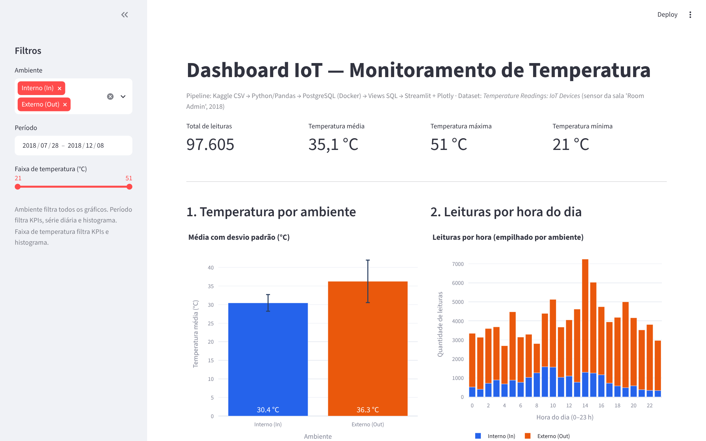
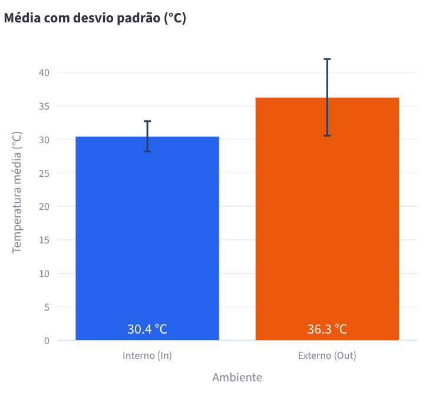
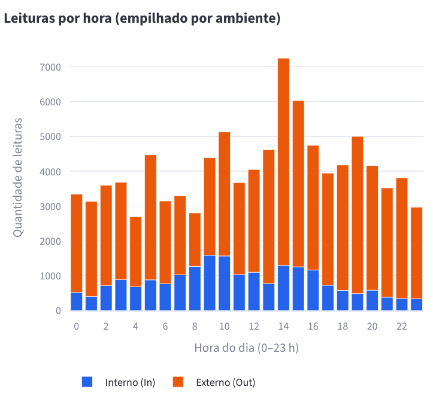
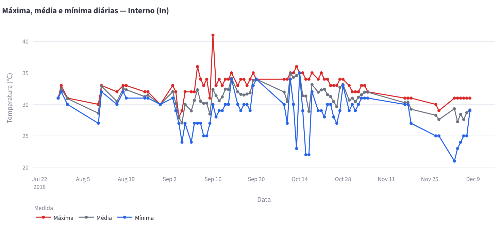
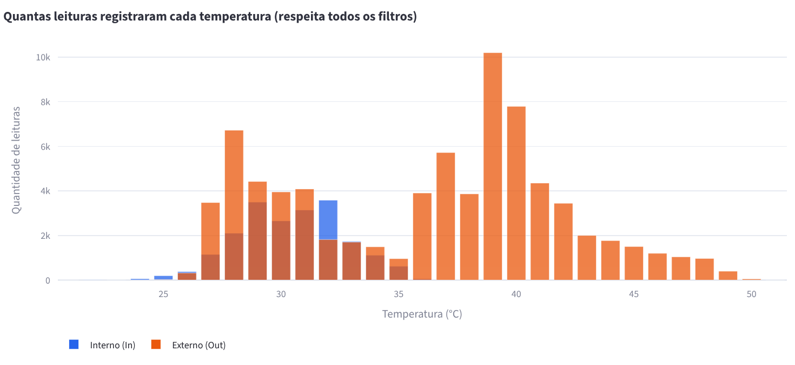

# Pipeline de Dados com IoT e Docker

Projeto da disciplina **Disruptive Architectures: IoT, Big Data e IA**.

## Sobre o projeto

Pipeline completo que pega leituras reais de um sensor de temperatura IoT, trata os dados com Python, armazena no PostgreSQL (rodando em Docker), resume a informação em views SQL e apresenta tudo em um dashboard interativo feito com Streamlit e Plotly.



## Tecnologias

| Tecnologia | Uso no projeto |
|---|---|
| Python 3.11+ | Linguagem de todo o pipeline |
| Pandas | Leitura, limpeza e validação do CSV |
| PostgreSQL 16 | Armazenamento da tabela e das views |
| Docker / Docker Compose | Sobe o PostgreSQL com um comando |
| SQLAlchemy + psycopg2 | Conexão do Python com o PostgreSQL |
| Streamlit | Interface web do dashboard |
| Plotly | Gráficos interativos |
| kagglehub | Download automático do dataset |
| Git / GitHub | Versionamento e entrega |
| Kaggle | Origem dos dados |

## Arquitetura

```
Kaggle (CSV) → Python/Pandas → PostgreSQL (Docker) → Views SQL → Streamlit + Plotly → Dashboard
```

1. **Extração:** `src/download_data.py` baixa o CSV do Kaggle (ou use o arquivo já incluído em `data/`).
2. **Transformação:** `src/load_data.py` renomeia colunas, converte data/hora e temperatura, remove nulos, inválidos e duplicados.
3. **Carga:** o mesmo script grava na tabela `temperature_readings` e cria as views de `sql/views.sql`.
4. **Validação:** `src/validate_db.py` consulta o banco e confirma que os dados e as views estão lá.
5. **Visualização:** `src/dashboard.py` lê as views e mostra os gráficos.

## Dataset

- **Nome:** Temperature Readings: IoT Devices
- **Link:** https://www.kaggle.com/datasets/atulanandjha/temperature-readings-iot-devices
- **Arquivo:** `IOT-temp.csv` (6,9 MB, incluído em `data/`)
- **Tamanho:** 97.606 linhas, 5 colunas, sem valores nulos e com 1 linha duplicada
- **Período:** 28/07/2018 a 08/12/2018 (86 dias com leituras dentro de um intervalo de 134 dias)

| Coluna original | Tipo | Conteúdo | Nome no banco |
|---|---|---|---|
| `id` | texto | id único da leitura | `reading_id` |
| `room_id/id` | texto | sala do sensor (sempre `Room Admin`) | `room_id` |
| `noted_date` | texto `DD-MM-YYYY HH:MM` | data e hora da leitura | `noted_at` (timestamp) |
| `temp` | inteiro | temperatura em °C (21 a 51) | `temperature` |
| `out/in` | texto | `In` = interno, `Out` = externo | `location` |

> O exemplo do enunciado usa `device_id` e `temperature`, mas o dataset real não tem `device_id`: todas as leituras vêm de uma única sala. Por isso as análises comparam **ambiente interno x externo**.

## Estrutura do projeto

```
pipeline-iot/
├── data/IOT-temp.csv        # dataset original do Kaggle
├── src/
│   ├── database.py          # conexão SQLAlchemy (lê o .env)
│   ├── download_data.py     # baixa o CSV via kagglehub (opcional)
│   ├── load_data.py         # limpeza + carga no PostgreSQL + criação das views
│   ├── validate_db.py       # consultas de validação no banco
│   └── dashboard.py         # dashboard Streamlit
├── sql/views.sql            # as 3 views comentadas
├── screenshots/             # prints do dashboard
├── docs/                    # relatório em PDF e roteiro do vídeo
├── .streamlit/config.toml   # tema e configuração do Streamlit
├── docker-compose.yml       # PostgreSQL 16
├── requirements.txt         # dependências Python
├── .env.example             # modelo das variáveis de ambiente
└── .gitignore
```

## Instalação

Pré-requisitos: **Python 3.11+**, **Git** e **Docker Desktop** (com o Docker em execução).

```bash
git clone https://github.com/SEU_USUARIO/pipeline-dados-iot.git
cd pipeline-dados-iot
```

Crie o arquivo `.env` a partir do modelo e escolha uma senha:

```powershell
# Windows (PowerShell)
copy .env.example .env
notepad .env
```
```bash
# Linux / macOS
cp .env.example .env
```

## Execução

```bash
# 1. Subir o PostgreSQL
docker compose up -d

# 2. Criar e ativar o ambiente virtual
python -m venv .venv
.venv\Scripts\Activate.ps1        # Windows (PowerShell)
# source .venv/bin/activate       # Linux / macOS

# 3. Instalar as dependências
pip install -r requirements.txt

# 4. (Opcional) baixar o CSV de novo do Kaggle
python src/download_data.py

# 5. Processar e carregar os dados
python src/load_data.py

# 6. Validar no banco
python src/validate_db.py

# 7. Abrir o dashboard (http://localhost:8501)
streamlit run src/dashboard.py

# Parar o banco quando terminar
docker compose down
```

> No Windows, se o PowerShell bloquear a ativação do venv, rode uma vez: `Set-ExecutionPolicy -Scope CurrentUser RemoteSigned`.

Saída esperada do passo 5:

```
[OK] Conectado: PostgreSQL 16...
[OK] CSV lido: IOT-temp.csv (97,606 linhas, ...)
     Registros lidos ........ 97,606
     Nulos removidos ........ 0
     Inválidos removidos .... 0
     Duplicados removidos ... 1
     Registros válidos ...... 97,605
[OK] Inseridos em temperature_readings: 97,605
```

O script pode ser executado quantas vezes quiser: ele esvazia e recarrega a tabela numa única transação, então nunca duplica dados.

## Banco de dados

Tabela `temperature_readings`:

| Coluna | Tipo | Restrição |
|---|---|---|
| `reading_id` | TEXT | chave primária |
| `room_id` | TEXT | NOT NULL |
| `noted_at` | TIMESTAMP | NOT NULL, indexada |
| `temperature` | SMALLINT | NOT NULL (°C) |
| `location` | TEXT | `'In'` ou `'Out'` |

Para consultar direto no contêiner:

```bash
docker exec -it postgres-iot psql -U iot_user -d iot_db -c "SELECT * FROM temperatura_media_ambiente;"
```

## Views SQL

O código completo e comentado está em [`sql/views.sql`](sql/views.sql).

**1. `temperatura_media_ambiente`**: uma linha por ambiente, com quantidade de leituras, média, mínima, máxima e desvio padrão. Serve para comparar o comportamento térmico interno e externo.

| ambiente | leituras | média | mín | máx | desvio |
|---|---|---|---|---|---|
| Out | 77.260 | 36,27 °C | 24 | 51 | 5,72 |
| In | 20.345 | 30,45 °C | 21 | 41 | 2,24 |

**2. `leituras_por_hora`**: para cada hora do dia (0–23) e ambiente, a quantidade de leituras e a temperatura média. Mostra quando os sensores mais transmitem e como a temperatura varia ao longo do dia.

**3. `temperatura_por_dia`**: para cada dia e ambiente, mínima, máxima, média e número de leituras. Permite acompanhar a evolução no tempo e encontrar dias atípicos ou sem coleta.

## Dashboard

Filtros na barra lateral: **ambiente**, **período** e **faixa de temperatura**.

- **KPIs:** total de leituras, temperatura média, máxima e mínima (respeitam os filtros).
- **Gráfico 1 – Temperatura por ambiente:** média com barras de desvio padrão (view 1).
- **Gráfico 2 – Leituras por hora do dia:** barras empilhadas por ambiente; o tooltip mostra a temperatura média da hora (view 2).
- **Gráfico 3 – Temperatura ao longo do tempo:** máxima, média e mínima diárias, um ambiente por vez (view 3).
- **Gráfico 4 – Distribuição das temperaturas:** quantas leituras caíram em cada grau, separadas por ambiente.

| | |
|---|---|
|  |  |




## Insights

Todos calculados a partir das views no PostgreSQL:

1. **O ambiente externo é mais quente e muito mais instável.** Média de 36,3 °C fora contra 30,4 °C dentro, e desvio padrão de 5,7 °C contra 2,2 °C. A sala amortece as variações de temperatura.
2. **Há uma mudança de patamar entre setembro e outubro.** A média externa passou de 31,2 °C em setembro para 39,9 °C em outubro e 40,2 °C em novembro. Os dias externos mais quentes foram 28 a 30/09/2018 (média de até 48,4 °C, máxima de 51 °C).
3. **79,2% das leituras são do sensor externo** (77.260 de 97.605), então médias gerais sem separar ambiente são puxadas para o lado externo.
4. **A coleta é irregular.** Houve leituras em apenas 86 dos 134 dias do período, e só o dia 17/10/2018 concentra 20.564 leituras (21% do dataset). Num sistema real, isso indicaria falhas de conexão ou envio em lote.
5. **O pico de envio é às 14h** (7.248 leituras), e o menor volume é às 4h (2.690).
6. **A temperatura externa média por hora é maior de madrugada (5h–6h, ~39,5 °C) e menor às 19h (33,6 °C).** Esse padrão vai contra o ciclo solar esperado, o que sugere que os horários foram registrados em outro fuso (provavelmente UTC). É um ponto a confirmar com a fonte antes de tirar conclusões por hora.

## Git

Comandos utilizados:

```bash
git init
git add .
git commit -m "Projeto inicial: Pipeline de Dados IoT"
git branch -M main
git remote add origin https://github.com/SEU_USUARIO/pipeline-dados-iot.git
git push -u origin main
git pull
```

## Autor

**Nome:** André Vitor de Oliveira Cirino (RA: 119010)  
**Professor:** Felipe Bonatto  
**Disciplina:** Disruptive Architectures: IoT, Big Data e IA
